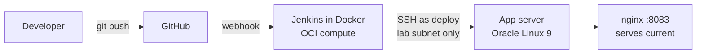
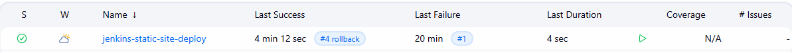
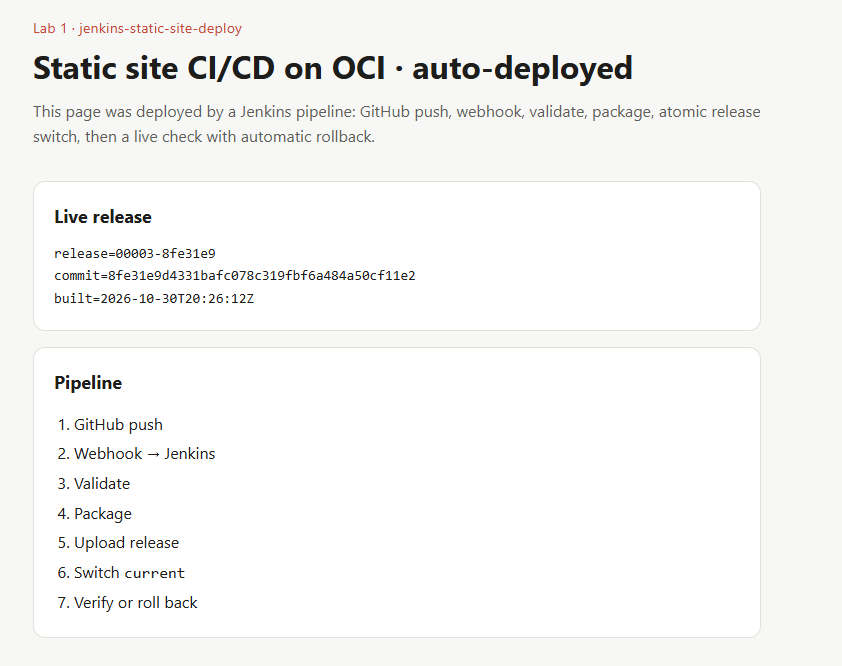

# jenkins-static-site-deploy

Static site CI/CD on Oracle Cloud Infrastructure: a push to `main` triggers a Jenkins pipeline
through a GitHub webhook, which validates and packages the site, uploads it as a new release,
switches it live atomically, and checks it is serving. If the check fails, it rolls back on its own.

Lab 1 of a series of CI/CD labs on OCI (GitHub · Jenkins · Docker · Oracle Linux app server).

## Architecture



## Pipeline

| Stage | What it does |
|:--|:--|
| Preflight | Checks `APP_HOST` is set, names the release `<build>-<commit>`, tests the SSH connection |
| Validate | `index.html` exists and has a title; blocks the build if a private key is committed |
| Package | Copies the site, writes `BUILD.txt` (release, commit, build time), creates a tarball |
| Deploy | Streams the tarball into `releases/<release>`, then switches `current` atomically |
| Verify | Fetches `BUILD.txt` through nginx until it shows the new release; rolls back if not |
| Rollback | Manual: run the job with `ACTION=rollback` to return to the previous release |

## Release layout on the app server

```
/var/www/static-site/
├── current -> releases/00007-3f2a9c1    # what nginx serves
└── releases/
    ├── 00005-91bd0e4
    ├── 00006-c03e7aa
    └── 00007-3f2a9c1                     # newest five are kept
```

Switching releases is a symlink rename (`mv -T`), so visitors never see a half-copied site.

## Security choices

- **Dedicated `deploy` user**, password login locked, no sudo.
- **The deploy key works only from the lab subnet**: `from="10.0.0.0/24"` in `authorized_keys`,
  plus no port, agent or X11 forwarding and no terminal.
- **Host key pinned** in Jenkins `known_hosts`; `BatchMode=yes` means an unknown host fails the build
  instead of prompting.
- **No secrets in the repo.** The SSH key is a Jenkins credential, the server address is a Jenkins
  global variable, and the pipeline refuses to deploy if a private key is committed.

## Set-up

1. On the app server: create the `deploy` user, release folders and an nginx site on port 8083.
2. In Jenkins:
   - Credential `app-server-deploy` (SSH username with private key, username `deploy`).
   - Global environment variable `APP_HOST` = the app server's private IP.
   - The app server's host key added to the Jenkins user's `~/.ssh/known_hosts`
     (verify its fingerprint against the server).
3. Create a Pipeline job → *Pipeline script from SCM* → this repository → branch `main`.
4. Add a GitHub webhook to `http://<jenkins>:8080/github-webhook/` (content type `application/json`).

## Rolling back

Jenkins → this job → **Build with Parameters** → `ACTION = rollback`. Each run steps back one release.

## Results



| Build | Trigger | Outcome |
|:--|:--|:--|
| #2 | Manual | First release deployed and verified |
| #3 | GitHub push (webhook) | New release deployed automatically and verified |
| #4 | Manual, `ACTION=rollback` | Switched back to the previous release |



## Licence

MIT

Built with the [ci-labs shared library](https://github.com/abdulzaferdevops/jenkins-shared-library).
